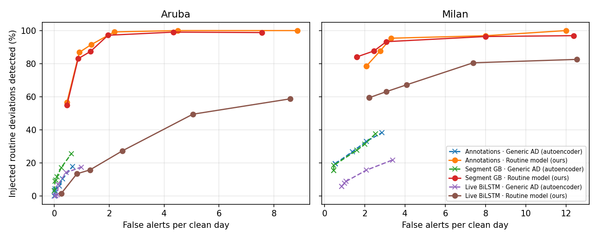

# Routine-deviation detection results

Generated by `python -m har.anomaly_report` from `<home>/anomaly/`. Protocol: decisions D12–D14 in `paper/decisions.md`; code: `har/run_anomaly.py`, `har/anomaly.py`.

Synthetic routine deviations are injected into the **raw sensor events** of the monitoring days (last 20 % of days). Each resident's routine is learned from the observation period (middle 20 %) of the same activity stream; recognisers are trained on the first 60 %. Thresholds are calibrated on the observation period to **0.1 alerts per normal day per routine aspect** (operating point below).

*Detection* = share of injected deviations matched by an alert. *F1* = day-level, per type, on a balanced set of injected and clean days, averaged over types. *False alerts* = alerts per clean monitoring day (on Milan these are Christmas-holiday days, so many are real routine changes). *Drift* = 7-day runs in which the first cooking episode moves 20 min later each day; detected = drift alert naming cooking within the run.

## Aruba

44 observation days, 44 monitoring days, 510 injected single-day copies (Missed 43, Prolonged 132, Unusual time 129, Night toilet trips 132, Inactivity 74) and 7 drift runs.

Recognition quality on the clean monitoring days (vs annotations): Segment GB macro-F1 89.5, accuracy 99.1; Live BiLSTM macro-F1 42.9, accuracy 64.8.

| Activity stream | Detector | Missed | Prolonged | Unusual time | Night toilet trips | Inactivity | Mean detection | F1 | False alerts / day | Drift runs detected (drift false alerts / day) |
|---|---|---|---|---|---|---|---|---|---|---|
| Annotations | Routine model (ours) | 100 | 70 | 95 | 100 | 93 | **92** | 73 | 1.34 | 2 / 7 (0.90) |
| Annotations | Generic AD (autoencoder) | 0 | 20 | 0 | 1 | 0 | **4** | 7 | 0.02 | – |
| Segment GB | Routine model (ours) | 98 | 68 | 91 | 100 | 80 | **87** | 71 | 1.32 | 2 / 7 (0.69) |
| Segment GB | Generic AD (autoencoder) | 0 | 29 | 17 | 2 | 0 | **10** | 15 | 0.05 | – |
| Live BiLSTM | Routine model (ours) | 5 | 11 | 13 | 39 | 11 | **16** | 16 | 1.30 | 0 / 7 (0.00) |
| Live BiLSTM | Generic AD (autoencoder) | 0 | 2 | 2 | 0 | 0 | **1** | 1 | 0.11 | – |

Median detection delay, routine model (minutes after the deviation starts; drift: days into the run):

| Activity stream | Missed | Prolonged | Unusual time | Night toilet trips | Inactivity | Drift |
|---|---|---|---|---|---|---|
| Annotations | 248 | 35 | 0 | 169 | 116 | 5.0 |
| Segment GB | 247 | 21 | 0 | 170 | 125 | 5.0 |
| Live BiLSTM | 372 | 14 | 4 | 180 | 133 | – |

Alerts on clean monitoring days by routine aspect (annotations stream): drift 38, unusual_time 19, frequency 15, timeline 10, prolonged 5, unusual_order 5, missed 4, inactivity 1.

Matched false-alert comparison: the generic baseline at its most sensitive setting (budget 1) vs the routine model's best detection at no more false alerts per clean day.

| Activity stream | Generic AD: detection @ false alerts/day | Routine model: detection @ false alerts/day |
|---|---|---|
| Annotations | 18 % @ 0.66 | 56 % @ 0.45 |
| Segment GB | 25 % @ 0.61 | 55 % @ 0.45 |
| Live BiLSTM | 17 % @ 0.98 | 13 % @ 0.82 |

Budget sweep, routine model: mean detection % / false alerts per clean day.

| Budget per aspect | Annotations | Segment GB | Live BiLSTM |
|---|---|---|---|
| 0.02 | 56 / 0.45 | 55 / 0.45 | 1 / 0.25 |
| 0.05 | 87 / 0.91 | 83 / 0.86 | 13 / 0.82 |
| 0.1 | 92 / 1.34 | 87 / 1.32 | 16 / 1.30 |
| 0.2 | 99 / 2.18 | 97 / 1.95 | 27 / 2.48 |
| 0.5 | 100 / 4.50 | 99 / 4.34 | 49 / 5.05 |
| 1 | 100 / 8.86 | 99 / 7.57 | 59 / 8.59 |

## Milan

13 observation days, 13 monitoring days, 166 injected single-day copies (Missed 13, Prolonged 39, Unusual time 39, Night toilet trips 39, Inactivity 36) and 2 drift runs.

Recognition quality on the clean monitoring days (vs annotations): Segment GB macro-F1 84.5, accuracy 93.5; Live BiLSTM macro-F1 43.3, accuracy 50.0.

| Activity stream | Detector | Missed | Prolonged | Unusual time | Night toilet trips | Inactivity | Mean detection | F1 | False alerts / day | Drift runs detected (drift false alerts / day) |
|---|---|---|---|---|---|---|---|---|---|---|
| Annotations | Routine model (ours) | 100 | 74 | 64 | 100 | 100 | **88** | 61 | 2.77 | 0 / 2 (0.00) |
| Annotations | Generic AD (autoencoder) | 0 | 5 | 23 | 69 | 0 | **19** | 20 | 0.54 | – |
| Segment GB | Routine model (ours) | 92 | 77 | 69 | 100 | 100 | **88** | 61 | 2.46 | 0 / 2 (0.00) |
| Segment GB | Generic AD (autoencoder) | 0 | 5 | 21 | 67 | 0 | **18** | 20 | 0.46 | – |
| Live BiLSTM | Routine model (ours) | 77 | 33 | 56 | 49 | 100 | **63** | 48 | 3.08 | 1 / 2 (0.18) |
| Live BiLSTM | Generic AD (autoencoder) | 0 | 10 | 8 | 15 | 6 | **8** | 10 | 1.00 | – |

Median detection delay, routine model (minutes after the deviation starts; drift: days into the run):

| Activity stream | Missed | Prolonged | Unusual time | Night toilet trips | Inactivity | Drift |
|---|---|---|---|---|---|---|
| Annotations | 42 | 34 | 0 | 152 | 66 | – |
| Segment GB | 42 | 17 | 0 | 152 | 66 | – |
| Live BiLSTM | 22 | 58 | 5 | 149 | 103 | 6.0 |

Alerts on clean monitoring days by routine aspect (annotations stream): timeline 10, missed 10, frequency 7, prolonged 4, unusual_order 4, inactivity 1.

Matched false-alert comparison: the generic baseline at its most sensitive setting (budget 1) vs the routine model's best detection at no more false alerts per clean day.

| Activity stream | Generic AD: detection @ false alerts/day | Routine model: detection @ false alerts/day |
|---|---|---|
| Annotations | 38 % @ 2.85 | 88 % @ 2.77 |
| Segment GB | 38 % @ 2.54 | 88 % @ 2.46 |
| Live BiLSTM | 22 % @ 3.38 | 63 % @ 3.08 |

Budget sweep, routine model: mean detection % / false alerts per clean day.

| Budget per aspect | Annotations | Segment GB | Live BiLSTM |
|---|---|---|---|
| 0.02 | 78 / 2.08 | 84 / 1.62 | 59 / 2.23 |
| 0.05 | 78 / 2.08 | 84 / 1.62 | 59 / 2.23 |
| 0.1 | 88 / 2.77 | 88 / 2.46 | 63 / 3.08 |
| 0.2 | 95 / 3.31 | 93 / 3.08 | 67 / 4.08 |
| 0.5 | 97 / 8.00 | 96 / 8.00 | 81 / 7.38 |
| 1 | 100 / 12.00 | 97 / 12.38 | 83 / 12.54 |

